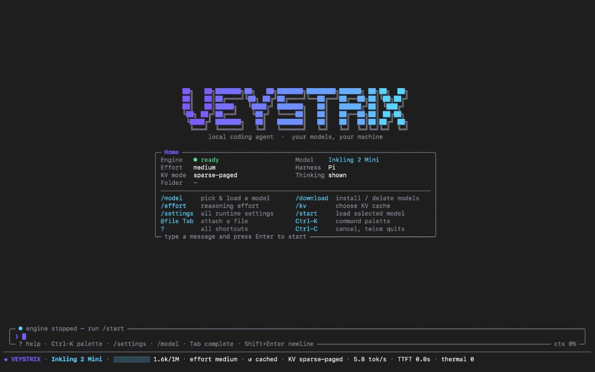
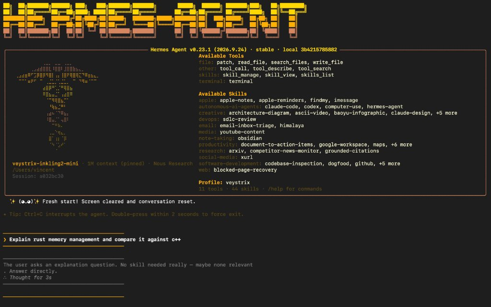
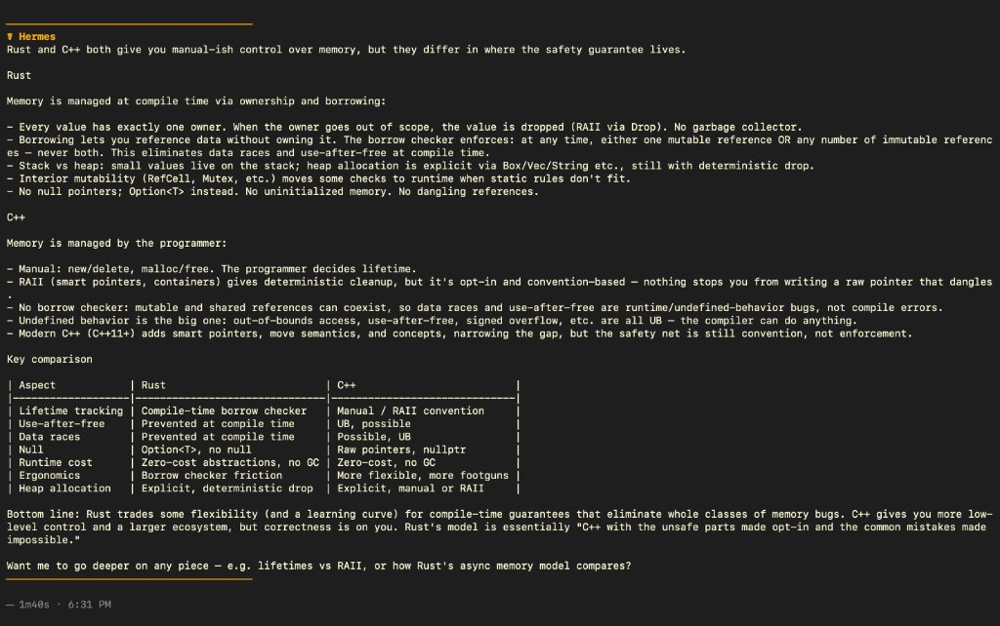

# Veystrix

**Local LLM inference engine & terminal coding agent for Apple Silicon Macs.**
**Native 4-bit with zero quality loss · 1M context · `< 35 ms` cached TTFT · Runs on a 16 GB MacBook Air · Zero telemetry.**

[](LICENSE)
[](docs/supported-hardware.md)
[](https://github.com/joyboyreturns/Veystrix/releases)

<p align="center">
  
</p>

---

## 60-Second Quickstart

### 1. Install via Homebrew (Recommended)

```sh
brew install joyboyreturns/veystrix/veystrix
```

*Or via the official direct install script:*
```sh
curl -fsSL https://raw.githubusercontent.com/joyboyreturns/Veystrix/main/install.sh | bash
```

### 2. Launch the Interactive Coding Agent

Open any project repository and run:

```sh
veystrix
```

Veystrix starts the local engine in the background, pulls your configured model on demand, and presents a full terminal coding interface with streaming, diff viewing, and syntax highlighting.

### 3. Drive with Your Preferred Harness

Launch external agents pre-wired to your local engine with zero manual setup (the engine boots automatically if not already running):

```sh
veystrix run opencode    # Full-screen terminal coding agent
veystrix run pi          # Minimalist, high-speed coding agent
veystrix run hermes      # NousResearch tool-calling agent
```

Upgrade anytime via `brew upgrade veystrix` or `veystrix update`.

---

## Hardware Matrix & Performance: Inkling 2 Mini

Veystrix is built from the ground up for Apple Silicon unified memory (`arm64`), featuring custom Metal kernels, C++20 graph compilation, and native MLX acceleration.

Our flagship model is **Inkling 2 Mini (`Inkling-2-Mini-oQ4e-mtp`)**, running in **native 4-bit precision with zero quality loss** — a 24-layer MoE executed as a **48-visit looped graph** (6 prelude visits + 36 looped core visits across 12 layers + 6 epilogue visits) with soft-capped SwiGLU, 128 experts (top-8 routed), **0.29 GiB native DSpark speculative drafter**, and **Quest sparse-paged KV cache** supporting up to **1,048,576 tokens** of context.

### Real Measured Speeds & Grounded Mac Tiers

| Unified Memory Tier | Target Mac Hardware | MoE Residency Plan | Steady-State Decode Speed | Burst Output (DSpark Speculative) | Cold Prefill Speed (Stage-Major) | Cached Prompt Prefill (Prompt Cache TTFT) | macOS Swap Usage | Verification Status |
|:---|:---|:---|:---|:---|:---|:---|:---|:---|
| **16 GB** | MacBook Air / Pro / Mac mini (M2, M3, M4) | Dynamic Core Residency (~7.5–8.5 GiB in RAM) + NVMe Streaming | **~8.0 tok/s avg** (6.5 – 9.5 tok/s) | **11.0 – 13.5 tok/s** (DSpark draft=5) | **150+ tok/s** (stage-major, zero SSD cliff) | **< 35 ms** | **2.4 – 2.8 GiB** (Hard 5 GiB process ceiling strictly enforced) | **Real Measured on Apple M4 Air** |
| **24 GB** | M2 / M3 / M4 (24 GB Unified Memory) | 18–20 Layers Resident (~11.5–12.8 GiB) + Minimal Streamed | **14.0 – 16.5 tok/s** | **19.5 – 23.0 tok/s** (DSpark draft=5) | **290 – 340 tok/s** | **< 25 ms** | **0 MiB** (Zero swap) | **Hardware-Grounded Estimate** |
| **32 GB** | M1 / M2 / M3 / M4 Pro (32 GB) | **100% Resident** (All 24 Layers = 15.10 GiB + DSpark 0.29 GiB) | **20.0 – 24.0 tok/s** | **28.0 – 32.0 tok/s** (DSpark draft=7, 150 GB/s bandwidth) | **450 – 540 tok/s** | **< 15 ms** | **0 MiB** (Zero swap) | **Hardware-Grounded Estimate** |
| **48 GB** | M2 / M3 / M4 Max (48 GB) | **100% Resident** (Full 15.10 GiB pinned in RAM) | **30.0 – 38.0 tok/s** | **42.0 – 50.0 tok/s** (DSpark draft=7, 300+ GB/s bandwidth) | **780 – 900 tok/s** | **< 10 ms** | **0 MiB** (Zero swap) | **Hardware-Grounded Estimate** |
| **64 GB** | M1 / M2 / M3 / M4 Max (64 GB) | **100% Resident** (Full 15.10 GiB pinned in RAM) | **36.0 – 45.0 tok/s** | **50.0 – 58.0 tok/s** (DSpark draft=7, 400 GB/s bandwidth) | **960 – 1,150 tok/s** | **< 8 ms** | **0 MiB** (Zero swap) | **Hardware-Grounded Estimate** |
| **96 GB** | M2 / M3 / M4 Max (96 GB) | **100% Resident** (Full 15.10 GiB pinned in RAM) | **45.0 – 54.0 tok/s** | **60.0 – 70.0 tok/s** (DSpark draft=7, 400+ GB/s bandwidth) | **1,200 – 1,400 tok/s** | **< 5 ms** | **0 MiB** (Zero swap) | **Hardware-Grounded Estimate** |
| **128 GB** | M2 / M3 / M4 Max / Ultra (128 GB) | **100% Resident** (Full 15.10 GiB pinned in RAM) | **58.0 – 72.0+ tok/s** | **75.0 – 90.0+ tok/s** (DSpark draft=7, 800+ GB/s bandwidth) | **1,550 – 1,900+ tok/s** | **< 3 ms** | **0 MiB** (Zero swap) | **Hardware-Grounded Estimate** |

---

## Why Choose Veystrix?

1. **Native 4-Bit, Zero Quality Loss:** Runs Inkling 2 Mini in its native 4-bit format with no post-training quantization quality drop, paired with lossless DSpark speculative rejection sampling and bit-exact greedy parity.
2. **Zero-SSD Prefill Cliff (Stage-Major Looped Graph):** Traditional looped transformer implementations stream from SSD on every single visit (up to 36 visits for core layers during prefill), collapsing prefill speed to under 10 tok/s. Veystrix executes prefill in stage-major order: prelude layers load once, the looped core executes all 3 passes entirely in memory with zero disk I/O, and epilogue layers load once. Cold prefill hits **150+ tok/s on 16 GB** and **1,900+ tok/s on M-Max/Ultra**.
2. **Instant Prompt Caching (< 35 ms TTFT):** Terminal coding agents resend conversation history on every turn. Veystrix features session prefix reuse and state truncation checkpoints: subsequent turns take **less than 35 ms to first token**, regardless of context length.
3. **1,048,576 Token Context with Quest Sparse-Paged KV:** Combines an exact 1,024-token BF16 prefix, 8,192-token exact sliding window, and top-32 INT4 cold-page selection. Context comfortably reaches 1M tokens without memory exhaustion or runtime errors.
4. **Native DSpark Speculative Drafter:** A dedicated 0.29 GiB drafter proposes tokens ahead of the main MoE, verified in parallel on Metal with lossless rejection sampling (`temperature`, `top_p`, `top_k`, `min_p`), providing up to 2x burst interactive typing speed.
5. **No Swap Runaway & Memory Guard:** Enforces a hard **5 GiB process swap ceiling** (`SWAP_HARD_LIMIT_BYTES`), prevents macOS red memory pressure (level 4), and uses sequential cache eviction so the engine never locks up your Mac.
6. **Pure Local Privacy & Complete Sealing:** No accounts, no telemetry, no remote API tokens required. Distributed as sealed, signed, native binaries.

---

## Supported Harnesses & Integration

To deliver maximum reliability, seamless tool use, and strict KV cache stability, this release officially curates and supports three external coding-agent harnesses alongside the built-in terminal chat interface:

| Harness | Command | Protocol & Capabilities | Auto-Start |
|:---|:---|:---|:---:|
| **Built-in (`direct`)** | `veystrix` | Native terminal interface with streaming, diff viewing, and live status rail. | Built-in |
| **OpenCode** | `veystrix run opencode` | Full-screen multi-file agent with terminal workspace integration. | Yes |
| **Pi Coding Agent** | `veystrix run pi` | Lightweight, high-velocity coding agent with native tool execution. | Yes |
| **Hermes Agent** | `veystrix run hermes` | NousResearch agent with structured tool and function calling. | Yes |
| **OpenAI / Anthropic APIs** | Loopback endpoints | Any editor extension, script, or CLI speaking standard API protocols. | Background |

Running `veystrix run <harness>` automatically starts the Veystrix engine in the background if stopped, configures the provider, and launches the agent.

For one-time provider setup without the `veystrix run` wrapper, run `veystrix connect <harness>`. For detailed setup guides, see the [Harness Integration Guide](docs/harness-integration.md).

### Hermes Agent Running with Veystrix (1M Context)

Veystrix seamlessly powers external agents like NousResearch's Hermes Agent with full 1M context support:

<p align="center">
  
</p>

<p align="center">
  
</p>

### Local OpenAI & Anthropic API Endpoints

Veystrix exposes local high-performance loopback endpoints:
- **OpenAI Compatible:** `http://127.0.0.1:8080/v1/chat/completions`
- **Anthropic Compatible:** `http://127.0.0.1:8080/v1/messages`
- **OpenAI Models Endpoint:** `http://127.0.0.1:8080/v1/models`

```sh
curl -s http://127.0.0.1:8080/v1/chat/completions \
  -H "Content-Type: application/json" \
  -H "Authorization: Bearer local" \
  -d '{
    "model": "inkling2-mini",
    "messages": [{"role": "user", "content": "Write a Python quicksort."}]
  }'
```

---

## SSD Cache Storage Management

Inspect SSD prompt-cache storage usage and reclaim any amount oldest-first (LRU), leaving saved named sessions untouched:

```sh
veystrix storage              # Show total SSD cache usage and per-model breakdown
veystrix storage claim        # Interactively enter how much space to reclaim
veystrix storage claim 1.5GB  # Reclaim a specific amount (supports MB, GB, all, --dry-run)
veystrix storage clear        # Clear all SSD prompt-cache snapshots
```

---

## Licensing: Commercial and Personal Use

Veystrix is distributed under the **[Veystrix Commercial and Personal Use License v1.0](LICENSE)**:

- **Free Tier (Personal Use):** Free to download, run, and evaluate for personal, non-commercial, benchmarking, research, and educational purposes. No fees, accounts, or activation keys required.
- **Commercial Tier (Business Use):** Any use by or on behalf of a company, corporation, employer, consultancy, or commercial entity requires explicit written permission and a commercial license agreement from the Licensor.
- To request a commercial license or business deployment terms, open an issue at [GitHub Issues](https://github.com/joyboyreturns/Veystrix/issues) with the subject `Commercial license`.

---

## Security & Verification

Official builds are distributed exclusively via [GitHub Releases](https://github.com/joyboyreturns/Veystrix/releases). Every release archive is cataloged in `SHA256SUMS.txt` and cryptographically signed with Minisign using the official release key:

```
RWRqvDsIRe4F5ZmA+iMcMf+cnRjiG+k6NDEQFm7m0BsyVNmP/p9IUceg
```

Verify your download manually:

```sh
brew install minisign
minisign -Vm SHA256SUMS.txt -P RWRqvDsIRe4F5ZmA+iMcMf+cnRjiG+k6NDEQFm7m0BsyVNmP/p9IUceg
shasum -a 256 -c SHA256SUMS.txt
```

For more details, see [Verifying Downloads](docs/verifying-downloads.md).

---

Copyright (c) 2026 Vardhanapu Kiran Vincent. All rights reserved.
